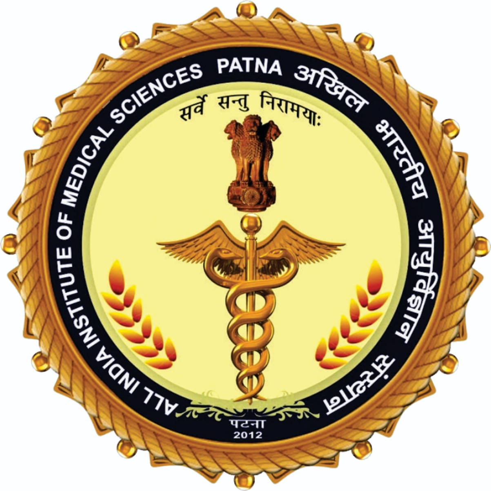

# Declaration By HOD {.unnumbered}

::: {.text-center}
{width="1.8in"}

**, **
:::

This is to certify that **** is a postgraduate resident of   course for the session , and  has independently carried out this thesis entitled **“”** for  in  at , , in , under the guidance of .

::: {.content-visible when-format="pdf"}
\\vfill
:::

::: {.text-center}

****






:::

Date: 

Place: , 



# Declaration By Guide {.unnumbered}

::: {.text-center}
{width="1.8in"}

**, **
:::

I hereby declare that this thesis work entitled **“”**, submitted as a requirement for the award of the  degree in , is the bona fide work of **** of , . This thesis work was carried out under our constant supervision and guidance and to my full satisfaction.

::: {.content-visible when-format="pdf"}
\\vfill
:::

::: {.text-center}

****






:::

Date: 

Place: , 



# Declaration by Coguides {.unnumbered}

::: {.text-center}
{width="1.8in"}

**, **
:::

I hereby declare that this thesis work entitled **“”**, submitted as a requirement for the award of the  degree in , is the bona fide work of **** of , . This thesis work was carried out under our constant supervision and guidance and to our full satisfaction.

::: {.content-visible when-format="pdf"}
\\vfill
:::

::: {layout-ncol=2}
::: {}
****




:::
::: {}
****




:::
:::

Date: 

Place: , 



# Declaration By Candidate {.unnumbered}

::: {.text-center}
{width="1.8in"}

**, **
:::

I hereby declare that this thesis work entitled **“”**, submitted in partial fulfillment of the requirements for  in  at , , is a record of original work done by me under the supervision of .

The information and data given in this work are authentic to the best of my knowledge. This research has not been submitted to any other university or institution for an award of any degree, diploma, or fellowship, or published previously.

::: {.content-visible when-format="pdf"}
\\vfill
:::

::: {.text-center}
****


:::

Date: 

Place: , 
